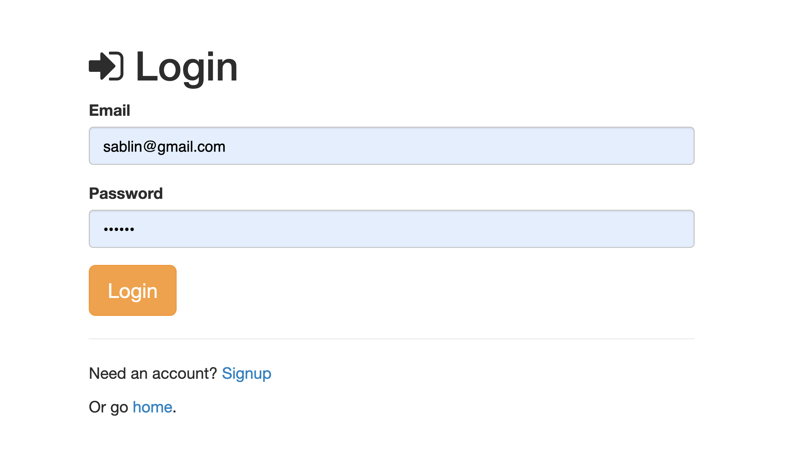
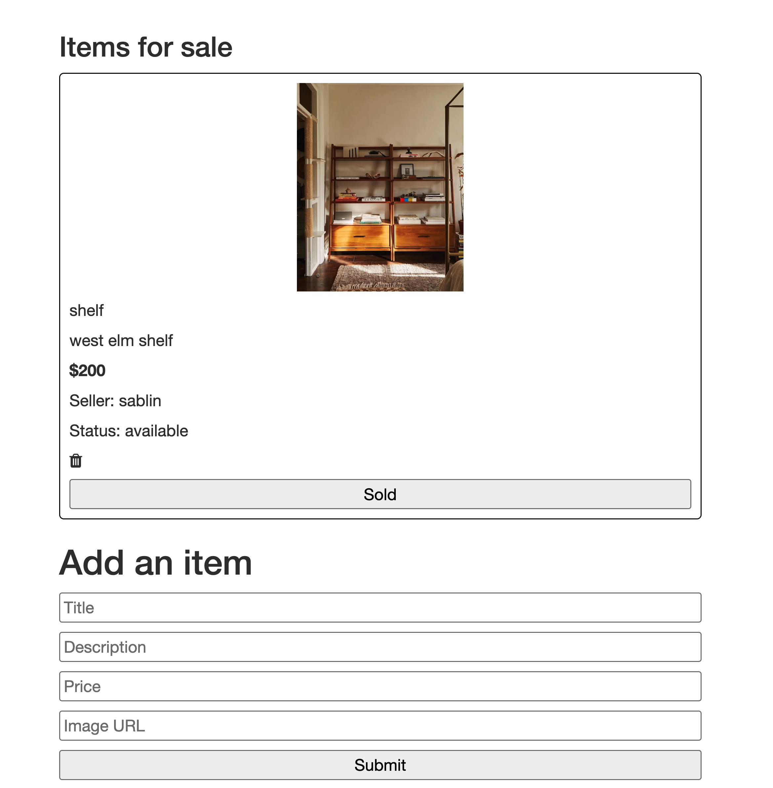
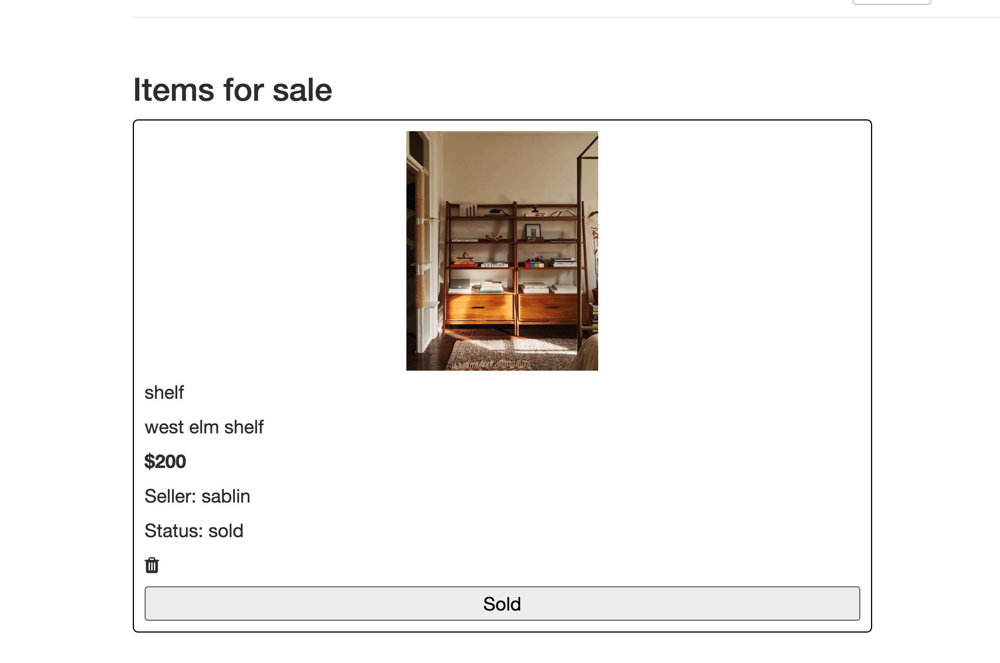

# Real Deal

Real Deal is a web app where buyers and sellers can list and browse second-hand deals. Create an account, post the items you want to sell, and browse what others have listed.

## Demo

Live: [https://realdeal-2.onrender.com](https://realdeal-2.onrender.com)

> The app runs on a free Render instance, so the first load may take about a minute.






## Features

- Sign up and log in with a local account
- Post an item with a name, description, price, and image URL
- Browse all listings in one place
- Responsive design

## Built With

- Node.js and Express
- MongoDB with Mongoose
- Passport.js (authentication)
- EJS templates
- Plain JavaScript and CSS

## Installation

1. Clone the repo
   ```bash
   git clone https://github.com/sabrinalindev/realdeal.git
   cd realdeal
   ```
2. Install dependencies
   ```bash
   npm install
   ```
3. Create a `.env` file in the project root with your MongoDB connection string
   ```
   DB_STRING=mongodb+srv://<username>:<password>@cluster0.xxxx.mongodb.net/dbname?retryWrites=true&w=majority
   ```

## Usage

1. Start the server
   ```bash
   node server.js
   ```
2. Open `http://localhost:8080` in your browser
3. Create an account, then post an item with a description, price, and image URL

## Deployment

Deployed on [Render](https://render.com) as a Web Service:

- Build command: `npm install`
- Start command: `node server.js`
- Environment variable: `DB_STRING` (your MongoDB Atlas connection string)

## What I Learned

- How to build routes with Express
- How to render dynamic pages with EJS
- How to connect an app to MongoDB and deploy it on Render using environment variables

## Credit

Modified from Scotch.io's authentication tutorial.

## License

Distributed under the MIT License. See `LICENSE` for details.
